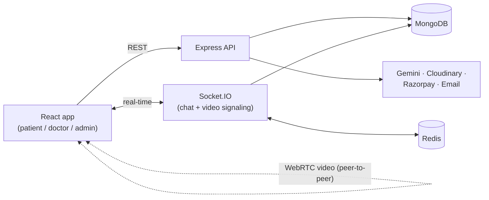

# Aura Health

A telemedicine platform that connects patients with doctors. Patients can book appointments, video-call and chat with doctors, use AI health tools, set medicine reminders, and get help fast in an emergency.

**Live:** [aurahealthh.vercel.app](https://aurahealthh.vercel.app)

## Features

**For patients**
- Book an appointment from a doctor's free slots
- Video consultation (WebRTC) and real-time chat with the doctor
- AI chatbot for health questions (Google Gemini)
- AI symptom triage: suggests which kind of doctor to see and how urgent it is
- Medical report analysis: upload a report and ask questions about it
- Skin analysis from a photo or live webcam
- Medicine reminders, with optional email alerts and a "taken / skipped" log
- Wellness tools for symptom logging, meal planning and meal photo recognition
- SOS: emergency contacts and nearby hospitals on a map with directions
- Rate doctors after a consultation

**For doctors**
- Apply with a certificate; the admin approves the application before the doctor is listed
- Manage appointments, chat with patients and join video calls
- See ratings and feedback
- Track consultation earnings and request withdrawals

**For admins**
- Approve or reject doctor applications
- Manage users, doctors and appointments
- Review completed consultations and withdrawal requests, and record payout references
- Receive email notifications for new doctor applications and withdrawal requests

**Credits and payouts**
- AI chat, report analysis and live skin analysis sessions use AI credits.
- Booking a consultation costs 100 consultation credits from a verified live Razorpay purchase. Consultation packs also include AI credits.
- Sample card number for checkout documentation is `4100 2800 0000 1007`. Aura Health's consultation checkout requires Razorpay Live Mode. For sandbox testing, use a [Razorpay-documented test card](https://razorpay.com/blog/accept-international-payments-webflow/) in a Test Mode checkout.
- Doctors can request withdrawals from cleared earnings. Admins review requests and record the payment reference after transferring funds.

## Tech Stack

| Part | Built with |
|---|---|
| Frontend | React 19, Vite, React Router, Tailwind CSS, Socket.IO client, Leaflet (maps), Recharts |
| Backend | Node.js, Express 5, MongoDB (Mongoose), Socket.IO, Redis |
| AI | Google Gemini (`gemini-2.5-flash`) |
| Services | Cloudinary (file uploads), Nodemailer (emails/OTP), Razorpay (payments), OpenStreetMap (maps) |
| Hosting | Vercel (frontend), AWS EC2 + Docker + Nginx (backend) |

## How It Works



- **REST API** handles logins, bookings, uploads, payments and the AI features.
- **Socket.IO** handles live chat and sets up the video call. The video itself goes directly between the two browsers.
- **Login** uses JWT cookies, with a separate login for each role (admin, doctor, user).

## Project Structure

```
AuraHealth/
├── Backend/
│   ├── index.js          # App entry point
│   ├── router/           # API routes
│   ├── service/          # Logic for each route
│   ├── model/            # MongoDB schemas
│   ├── middleware/       # Login checks, file upload, rate limiting
│   ├── helper/           # Shared helpers (credits, reminders)
│   ├── socket/           # Chat and video-call socket handlers
│   └── config/           # Cloudinary, Redis, Gemini, CORS setup
├── Frontend/
│   └── src/
│       ├── pages/        # One file per page
│       └── components/   # Shared UI and layouts
├── nginx/                # Nginx config
├── docker-compose.yml
└── docs/                 # Detailed docs and UML diagrams
```

## Run It Locally

Use **Node.js 22**, which matches CI and the backend Docker image. The backend needs Redis at startup and a MongoDB connection. Use MongoDB Atlas or a replica set for workflows that use transactions, including booking and payments.

Configure Gmail credentials for OTP and email notifications, Cloudinary for uploads, and a Gemini API key for AI features. Consultation checkout requires live Razorpay credentials. Leave the Razorpay values blank to run locally with checkout disabled.

### 1. Backend

```bash
cd Backend
npm ci
```

Create `Backend/.env`:

```env
PORT=5000
MONGO_URI=your_mongodb_url
REDIS_URL=redis://localhost:6379
JWT_SECRET=any_long_random_text
CORS_ORIGINS=http://localhost:5173

EMAIL=your_gmail_address
PASS_KEY=your_gmail_app_password

CLOUD_NAME=cloudinary_cloud_name
API_KEY=cloudinary_api_key
API_SECRET=cloudinary_api_secret

GEMINI_API_KEY=your_gemini_key

RAZORPAY_KEY_ID=
RAZORPAY_KEY_SECRET=
RAZORPAY_WEBHOOK_SECRET=
FRONTEND_URL=http://localhost:5173
```

Start the backend:

```bash
npm start
```

### 2. Frontend

Open a second terminal at the repository root.

```bash
cd Frontend
npm ci
```

Create `Frontend/.env`:

```env
VITE_API_URL=http://localhost:5000
```

Start the frontend:

```bash
npm run dev
```

Open http://localhost:5173. Check backend connectivity at http://localhost:5000/healthz.

## Deployment

- Vercel hosts the frontend. Set `VITE_API_URL` to the public backend URL and include the frontend origin in the backend's `CORS_ORIGINS` list.
- The backend runs on AWS EC2. From the repository root on the server, run `docker compose up -d --build` after pulling changes. The Compose configuration starts two backend instances behind Nginx, with MongoDB and Redis configured through `Backend/.env`.
- For Razorpay webhook verification, configure `/razorpay/webhook` with the same secret as `RAZORPAY_WEBHOOK_SECRET`.

`GET /healthz` returns HTTP 200 when MongoDB is connected and HTTP 503 otherwise.

GitHub Actions runs frontend lint and build checks, backend syntax checks, and a backend Docker build for pushes and pull requests targeting `main`.

## More Docs

- [docs/PROJECT_STRUCTURE.md](docs/PROJECT_STRUCTURE.md) — what each file does
- [docs/uml.md](docs/uml.md) — UML diagrams (use case, sequence, class and more)
- [docs/INTERVIEW_PREP.md](docs/INTERVIEW_PREP.md) — why each technology was chosen

## License

This project is licensed under the [MIT License](LICENSE).
