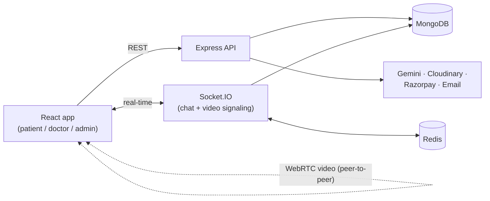

# Aura Health

A telemedicine platform that connects patients with doctors. Patients can book appointments, video-call and chat with doctors, use AI health tools, set medicine reminders, and get help fast in an emergency.

**Live:** [aurahealthh.vercel.app](https://aurahealthh.vercel.app)

## Features

**For patients**
- Book an appointment from a doctor's free slots
- Video consultation (WebRTC) and real-time chat with the doctor
- AI chatbot for health questions (Google Gemini)
- AI symptom triage: suggests which kind of doctor to see and how urgent it is
- Medical report analysis: upload a report and ask questions about it
- Skin analysis from a photo or live webcam
- Medicine reminders, with optional email alerts and a "taken / skipped" log
- SOS: emergency contacts and nearby hospitals on a map with directions
- Rate doctors after a consultation

**For doctors**
- Apply with a certificate; the admin approves the application before the doctor is listed
- Manage appointments, chat with patients and join video calls
- See ratings and feedback

**For admins**
- Approve or reject doctor applications
- Manage users, doctors and appointments

**Credits**
- Paid features (AI chat, report analysis, skin analysis, booking) cost credits
- Users buy credit packs through Razorpay

## Tech Stack

| Part | Built with |
|---|---|
| Frontend | React 19, Vite, React Router, Tailwind CSS, Socket.IO client, Leaflet (maps), Recharts |
| Backend | Node.js, Express 5, MongoDB (Mongoose), Socket.IO, Redis |
| AI | Google Gemini (`gemini-2.5-flash`) |
| Services | Cloudinary (file uploads), Nodemailer (emails/OTP), Razorpay (payments), OpenStreetMap (maps) |
| Hosting | Vercel (frontend), AWS EC2 + Docker + Nginx (backend) |

## How It Works



- **REST API** handles logins, bookings, uploads, payments and the AI features.
- **Socket.IO** handles live chat and sets up the video call. The video itself goes directly between the two browsers.
- **Login** uses JWT cookies, with a separate login for each role (admin, doctor, user).

## Project Structure

```
AuraHealth/
├── Backend/
│   ├── index.js          # App entry point
│   ├── router/           # API routes
│   ├── service/          # Logic for each route
│   ├── model/            # MongoDB schemas
│   ├── middleware/       # Login checks, file upload, rate limiting
│   ├── helper/           # Shared helpers (credits, reminders)
│   ├── socket/           # Chat and video-call socket handlers
│   └── config/           # Cloudinary, Redis, Gemini, CORS setup
├── Frontend/
│   └── src/
│       ├── pages/        # One file per page
│       └── components/   # Shared UI and layouts
├── nginx/                # Nginx config
├── docker-compose.yml
└── docs/                 # Detailed docs and UML diagrams
```

## Run It Locally

You need **Node.js 20.19+**, plus accounts for MongoDB, Redis, Cloudinary, Gemini and Razorpay (test mode).

### 1. Backend

```bash
cd Backend
npm install
```

Create `Backend/.env`:

```env
PORT=5000
MONGO_URI=your_mongodb_url
REDIS_URL=your_redis_url
JWT_SECRET=any_long_random_text
CORS_ORIGINS=http://localhost:5173

EMAIL=your_gmail_address
PASS_KEY=your_gmail_app_password

CLOUD_NAME=cloudinary_cloud_name
API_KEY=cloudinary_api_key
API_SECRET=cloudinary_api_secret

GEMINI_API_KEY=your_gemini_key

RAZORPAY_KEY_ID=rzp_test_xxx
RAZORPAY_KEY_SECRET=xxx
RAZORPAY_WEBHOOK_SECRET=xxx        # optional
FRONTEND_URL=http://localhost:5173 # optional, used in reminder emails
```

Start the backend:

```bash
npm run dev
```

### 2. Frontend

```bash
cd Frontend
npm install
```

Create `Frontend/.env`:

```env
VITE_API_URL=http://localhost:5000
```

Start the frontend:

```bash
npm run dev
```

Open http://localhost:5173.

## Deployment

- **Frontend:** Vercel deploys it automatically on every push to `main`.
- **Backend:** runs in Docker on AWS EC2, behind Nginx. It does **not** update on push. To deploy, pull the new code on the server, rebuild the Docker image, and restart the container.
- `docker-compose.yml` can also run two backend copies behind Nginx when you need to scale up.

Health check: `GET /healthz` returns the server and database status.

## More Docs

- [docs/PROJECT_STRUCTURE.md](docs/PROJECT_STRUCTURE.md) — what each file does
- [docs/uml.md](docs/uml.md) — UML diagrams (use case, sequence, class and more)
- [docs/INTERVIEW_PREP.md](docs/INTERVIEW_PREP.md) — why each technology was chosen
