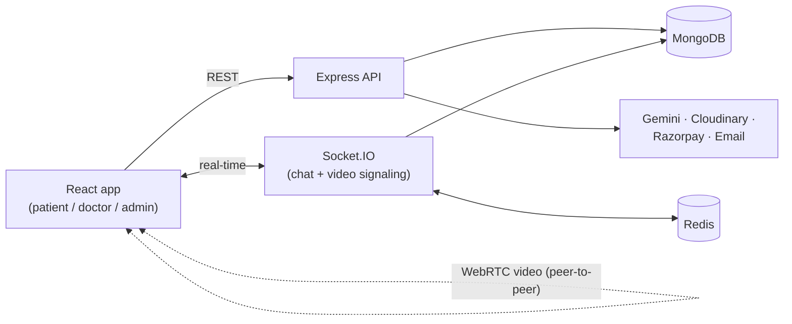

# Aura Health

A telemedicine platform that connects patients with doctors. Patients can book appointments, video-call and chat with doctors, use AI health tools, set medicine reminders, and get help fast in an emergency.

**Live:** [aurahealthh.vercel.app](https://aurahealthh.vercel.app)

## Features

### Accounts and doctor discovery

- Patients register with email OTP verification. Patients and doctors can edit their profiles, upload a profile photo, change their password, or reset it using an email OTP.
- Patients, doctors, and admins sign in through a shared login screen with a role selector. Each role has its own dashboard and navigation.
- Doctors apply with a certificate. Admins review the application before the doctor can register and appear in the directory.
- Patients can search doctors by name, specialty, or hospital, filter by specialty, and browse public profiles with ratings and reviews.
- The first admin account can be created through `/admin-setup`.

### Booking and consultations

- A guided booking flow lets patients select a doctor, pick a date and an available slot, enter the reason for the visit, and confirm the booking. Patients and doctors can view upcoming and past appointments from their dashboards.
- Patients and doctors can exchange real-time messages and reopen saved conversations. Appointment video rooms use WebRTC with microphone and camera controls.
- Patients can allow or revoke sharing for each appointment. The doctor's visit briefing shows the reason for the visit and, when shared, recent report summaries and the last seven days of doses marked taken or skipped.
- Once a visit starts, doctors can publish instructions to start, stop, or change a medicine. Patients review each change and can apply it to their reminder schedule.
- Patients can leave a star rating and written feedback after a consultation. Doctors can review their feedback.
- Admins can schedule and approve pending appointment requests or reject them.

### AI health and wellness tools

- The Gemini health chatbot streams replies, supports limited guest access, and offers voice dictation and read-aloud on supported browsers.
- Symptom triage suggests an urgency level and a relevant specialty, with matching doctors when available.
- Patients can upload PDF medical reports for AI summaries, ask follow-up questions, reopen or delete saved reports, and generate a written trends summary across their report history.
- Skin analysis supports uploaded photos and live webcam captures. The live tool supports voice input for describing concerns and read-aloud for results.
- The live camera page also offers an experimental pulse estimate computed in the browser from webcam frames.
- The wellness page offers one-day meal planning, meal-photo recognition, and a symptom journal with recent entries, voice dictation, and entry deletion.
- Voice input offers English, Hindi, Tamil, Telugu, Bengali, and Marathi on supported browsers.

### Medication reminders

- Patients can add, edit, pause, resume, and delete reminders, with multiple daily times and optional course end dates.
- Prescription photo scanning prepares reminder drafts for review. The medicine-label scanner helps identify medicines from packaging photos.
- The daily checklist lets patients mark doses taken or skipped, undo a log entry, and view seven-day adherence.
- Reminders support in-app alerts, browser notifications with permission, and optional email alerts.

### Emergency tools

- Patients can save emergency contacts and open call or WhatsApp actions for each contact.
- Press and hold SOS to open emergency actions, including calling 112 and sharing your location in a prefilled WhatsApp message.
- The nearby care map uses browser geolocation or a searched location to find hospitals and nearby doctors. It can use a health concern to prioritize relevant doctors and offers routes on the map or in Google Maps.

### Credits and payouts

- The wallet tracks AI and consultation credits separately and shows transaction history. It starts with 30 welcome AI credits. An AI chat message costs 1 credit, a report analysis costs 10, and a 10-minute live skin analysis session costs 5.
- Booking costs 100 consultation credits from a verified Razorpay Live Mode purchase. Starter, Plus, and Pro packs include 100, 300, and 1,000 consultation credits plus 10, 30, and 100 AI credits, respectively.
- Razorpay checkout and webhooks verify payments before credits are added to the wallet.
- **Razorpay Test Mode card** for a sandbox checkout: `4239 5360 0631 5640` (Visa, any CVV and any future expiry). AuraHealth's consultation checkout requires Razorpay Live Mode. [Razorpay test card guide](https://razorpay.com/blog/accept-international-payments-webflow/)
- Doctors can track earnings, see available balances and payout history, and request withdrawals from cleared earnings.
- Admins confirm completed consultations, can place earnings on hold or release them, and review withdrawal requests. They record the payment reference after transferring funds.

### Administration and analytics

- The admin dashboard includes user and doctor directories, account blocking, doctor removal, certificate review, and approved and rejected application lists.
- Admins receive email notifications for new doctor applications and withdrawal requests.
- Doctors can chart bookings, unique and repeat patients, and ratings. Admins can track bookings, paid orders, gross payments, and credits purchased or spent. Both analytics dashboards offer 7-, 30-, and 90-day views and CSV exports.

## Tech Stack

| Part | Built with |
|---|---|
| Frontend and build | JavaScript and JSX, React 19 for component state and UI, React Router 7 for role-based route trees, Vite 7 and its React plugin for development and production builds, Tailwind CSS 4 and its Vite plugin for styling |
| UI and browser APIs | Lucide React for icons, react-phone-number-input for contact forms, Recharts for analytics graphs, Leaflet and React Leaflet for interactive maps, Canvas for image capture and pulse sampling, Geolocation for nearby care, Web Speech for dictation and playback, Notifications and localStorage for reminder alerts |
| Network and real time | Axios for REST and external HTTP calls, Fetch and browser streams for AI replies, Socket.IO server and client for messaging and signaling, WebRTC and STUN for calls |
| API and configuration | Node.js 22, Express 5, dotenv for environment configuration, cors and cookie-parser for credentialed HTTP requests, compression for HTTP payloads, Multer for multipart uploads |
| Identity and integrity | jsonwebtoken for signed sessions, js-cookie for browser cookie access, bcrypt for patient passwords and bcryptjs for doctor and admin passwords, Node.js crypto for OTP generation and payment signatures |
| Data and coordination | MongoDB with Mongoose for schemas, indexes, aggregation and transactions. Redis with the Node Redis client, Socket.IO Redis adapter, express-rate-limit, and rate-limit-redis for cross-instance events and shared quotas |
| AI | Google Gemini API through `@google/generative-ai`, configured to use `gemini-2.5-flash` |
| File storage and email | Cloudinary SDK and streamifier for uploads, Nodemailer with Gmail SMTP for account emails, reminders and admin notifications |
| Maps and payments | OpenStreetMap tiles and Overpass hospital data, Nominatim for place lookup, OSRM for road distances and routes, Google Maps directions links, Razorpay SDK and Checkout for orders and payments |
| Build and operations | npm lockfiles and `npm ci`, Nodemon for backend development, ESLint with React Hooks and React Refresh rules, GitHub Actions for checks, Vercel for frontend hosting, AWS EC2 with Docker Compose and Nginx for the API |

## How It Works



- **REST API** handles logins, bookings, uploads, payments and the AI features.
- **Socket.IO** handles live chat and sets up the video call. The video itself goes directly between the two browsers.
- **Login** uses JWT cookies, with a separate login for each role (admin, doctor, user).
- **Redis** shares Socket.IO events across backend instances and backs API rate limits.

### Request and data flows

| Workflow | How it works |
|---|---|
| Accounts | Email verification stages a pending patient record before account creation. MongoDB TTL fields expire pending registrations and password reset codes. Express middleware resolves role sessions for protected routes, and Socket.IO verifies a JWT during its handshake. CORS allowlists configure which browser origins can make credentialed requests. |
| Appointment booking | The server calculates available slots and validates the selection again at booking time. One MongoDB transaction consumes consultation credits from eligible payment records, creates the appointment, and writes the ledger entry. A unique doctor/date/time index prevents two successful bookings of the same slot. A partial unique patient/date index applies the per-day constraint to paid bookings. |
| Payments and payouts | The backend creates Razorpay orders and checks payment details and capture status. Checkout and webhook signatures use HMAC-SHA256 and timing-safe comparison, with the webhook verified against the original request bytes. A conditional update and transaction prevent duplicate credit grants when confirmation arrives through both paths. Refund and dispute events can block affected funding. Payout review uses conditional state changes, a withdrawal request key, and unique payout references to avoid duplicate processing. |
| Chat and calls | Chat messages are stored in MongoDB and broadcast to a Socket.IO conversation room. REST endpoints return saved conversations. For meetings, the server validates the appointment and relays WebRTC offers, answers, and ICE candidates. Browsers exchange media directly when a connection can be established, keeping video traffic off the application servers. |
| Reminders | Schedule times are evaluated in the patient's configured time zone. The browser checks for due alerts and uses localStorage to avoid repeating alerts already shown. Each backend instance runs an email scheduler, with an atomic dose-log claim and unique reminder/date/time index coordinating delivery across instances. Failed sends clear the claim so a later eligible pass can retry. |
| Nearby care | MongoDB's `2dsphere` index and `$geoNear` find nearby AuraHealth doctors. Overpass supplies hospital locations, Nominatim resolves a searched place, and OSRM adds road distances and route geometry. The app can fall back to straight-line distances where road distances are unavailable. |
| Analytics | MongoDB aggregation computes booking, ratings, payment and credit metrics over a selected date range. React renders the returned series in Recharts and builds the CSV export in the browser. |

## How AI is used

The Express backend calls Gemini using the server-side `GEMINI_API_KEY`. Each feature supplies its own prompt and input. Image and PDF features send selected files or frames as MIME-typed inline data. Triage and scanning features request JSON where the UI needs structured fields. The service parses the response, and features such as meal scanning and prescription scanning bound the size of the returned data before rendering it.

| AI feature | What goes to Gemini and what happens next |
|---|---|
| Health assistant | The backend sends the user's prompt and, when selected, a language instruction. The streaming endpoint iterates over Gemini response chunks and emits Server-Sent Events (SSE) over an HTTP POST. The browser reads the response stream and appends chunks to the answer. Redis-backed quotas limit guest usage, and signed-in requests debit AI credits. |
| Symptom triage | A text prompt includes the symptom description and the specialties present in the doctor directory. It requests a specialty, urgency label, and short explanation. Nearby care can use the inferred specialty when looking up doctors. |
| Report analysis | The initial request sends the PDF with a prompt for a plain-language summary. Cloudinary stores the original, and MongoDB stores the summary, file reference and message history. For a follow-up, the current backend passes the submitted question text to Gemini and saves the exchange to the report. The separate trends flow sends dated summaries from at least two reports and returns a written comparison. |
| Skin analysis | The service sends a photo or a sampled webcam frame with the patient's optional concern. Live analysis uses a credit-funded session with a server-checked expiry. The frontend encodes frames as JPEG, allows one analysis request at a time, and pauses AI frame submissions during pulse measurement. |
| Prescription and medicine-label scans | Prescription scans extract readable information into editable drafts. A patient reviews the drafts before saving reminders. The label scanner extracts printed product name and strength from a package photo, then the server compares the normalized name with the patient's active reminders. |
| Meal planner and photo scan | The planner turns diet, preferences and exclusions into breakfast, lunch and dinner ideas. The photo scanner returns recognizable foods as a bounded list that the backend deduplicates. |

Browser speech recognition converts audio to text before a prompt is sent, and browser speech synthesis reads supported results aloud. The visit briefing is assembled from appointment and consented records in MongoDB. The experimental camera pulse feature uses local Canvas sampling and signal processing on a small forehead region over 30 seconds. These workflows run outside the Gemini integration.

## Performance and scalability

| Design choice | What it improves |
|---|---|
| Route-level code splitting | React `lazy` and Vite load pages on demand. Maps, charts and other page-specific code can load with the routes that need them. Selected screens use `AbortController` to cancel superseded requests and run independent requests concurrently. |
| Compression and streaming | Express compresses eligible HTTP responses. SSE is exempted from compression, and Nginx disables proxy buffering for `/chat/stream` so generated text can reach the browser as it arrives. |
| Targeted database work | Compound indexes cover common access patterns such as conversation history, credit history and scheduled doses. Selected service queries use field projections, read-only `lean()` results, pagination or bounded history. Aggregations compute metrics in MongoDB. |
| Shared state across API replicas | Nginx distributes traffic between the two backend containers using IP affinity and forwards WebSocket upgrades. Redis Pub/Sub distributes socket events between instances and centralizes rate-limit counters. Durable application records are shared through MongoDB, and uploaded files go to Cloudinary. |
| Bounded and cached external work | The maps helper caches hospital results for 10 minutes per process by rounded coordinates and radius, uses timeouts and alternate Overpass endpoints, and batches road-distance lookups through OSRM's table endpoint. Selected AI endpoints use input or upload limits, Redis throttling, AI credit checks, or session expiry to bound work. |
| Deployment lifecycle | Compose waits for both backend containers to pass MongoDB-backed health checks before starting Nginx. The Node process handles termination signals by closing sockets, stopping the reminder scheduler and releasing database connections. CI runs frontend lint and build checks, backend syntax checks, and a Docker image build. |

The Compose topology runs two API replicas on one EC2 host, so host and proxy availability remain shared. MongoDB, Redis and external-provider quotas constrain throughput as traffic grows. The hospital cache is local to each process, reminder scheduling runs in each replica, and WebRTC currently configures STUN without a TURN relay, which can limit call connectivity on restrictive networks. Some queries, including the report trends history, grow with user data. The repository configuration establishes these design properties. Throughput, latency, and failover capacity would require load and resilience measurements.

## Project Structure

```
AuraHealth/
├── Backend/
│   ├── index.js          # App entry point
│   ├── router/           # API routes
│   ├── service/          # Logic for each route
│   ├── model/            # MongoDB schemas
│   ├── middleware/       # Login checks, file upload, rate limiting
│   ├── helper/           # Shared helpers (credits, reminders)
│   ├── socket/           # Chat and video-call socket handlers
│   └── config/           # Cloudinary, Redis, Gemini, CORS setup
├── Frontend/
│   └── src/
│       ├── pages/        # One file per page
│       └── components/   # Shared UI and layouts
├── nginx/                # Nginx config
├── docker-compose.yml
└── docs/                 # Detailed docs and UML diagrams
```

## Run It Locally

Use **Node.js 22**, which matches CI and the backend Docker image. The backend needs Redis at startup and a MongoDB connection. Use MongoDB Atlas or a replica set for workflows that use transactions, including booking and payments.

Configure Gmail credentials for OTP and email notifications, Cloudinary for uploads, and a Gemini API key for AI features. Consultation checkout requires live Razorpay credentials. Leave the Razorpay values blank to run locally with checkout disabled.

### 1. Backend

```bash
cd Backend
npm ci
```

Create `Backend/.env`:

```env
PORT=5000
MONGO_URI=your_mongodb_url
REDIS_URL=redis://localhost:6379
JWT_SECRET=any_long_random_text
CORS_ORIGINS=http://localhost:5173

EMAIL=your_gmail_address
PASS_KEY=your_gmail_app_password

CLOUD_NAME=cloudinary_cloud_name
API_KEY=cloudinary_api_key
API_SECRET=cloudinary_api_secret

GEMINI_API_KEY=your_gemini_key

RAZORPAY_KEY_ID=
RAZORPAY_KEY_SECRET=
RAZORPAY_WEBHOOK_SECRET=
FRONTEND_URL=http://localhost:5173
```

Start the backend:

```bash
npm start
```

### 2. Frontend

Open a second terminal at the repository root.

```bash
cd Frontend
npm ci
```

Create `Frontend/.env`:

```env
VITE_API_URL=http://localhost:5000
```

Start the frontend:

```bash
npm run dev
```

Open http://localhost:5173. Check backend connectivity at http://localhost:5000/healthz.

## Deployment

- Vercel hosts the frontend. Set `VITE_API_URL` to the public backend URL and include the frontend origin in the backend's `CORS_ORIGINS` list.
- The backend runs on AWS EC2. From the repository root on the server, run `docker compose up -d --build` after pulling changes. The Compose configuration starts two backend instances behind Nginx, with MongoDB and Redis configured through `Backend/.env`.
- For Razorpay webhook verification, configure `/razorpay/webhook` with the same secret as `RAZORPAY_WEBHOOK_SECRET`.

`GET /healthz` returns HTTP 200 when MongoDB is connected and HTTP 503 otherwise.

GitHub Actions runs frontend lint and build checks, backend syntax checks, and a backend Docker build for pushes and pull requests targeting `main`.

## More Docs

- [docs/PROJECT_STRUCTURE.md](docs/PROJECT_STRUCTURE.md) — what each file does
- [docs/uml.md](docs/uml.md) — UML diagrams (use case, sequence, class and more)

## License

This project is licensed under the [MIT License](LICENSE).
