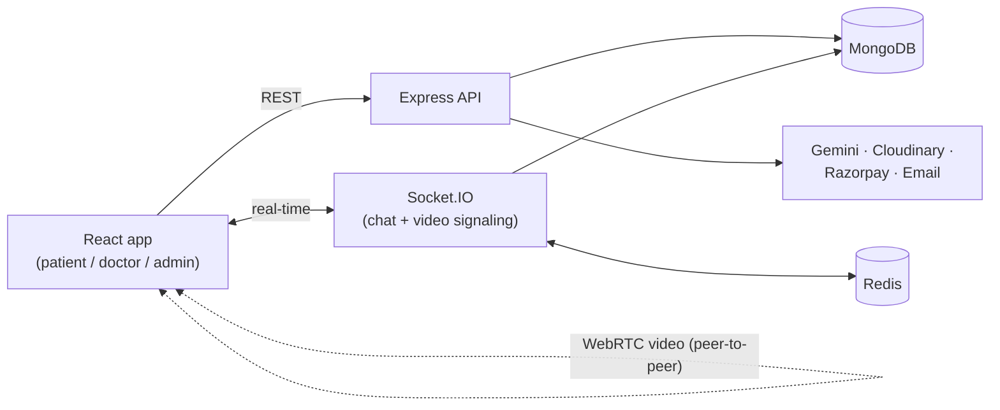

# Aura Health

A telemedicine platform that connects patients with doctors. Patients can book appointments, video-call and chat with doctors, use AI health tools, set medicine reminders, and get help fast in an emergency.

**Live:** [aurahealthh.vercel.app](https://aurahealthh.vercel.app)

## Features

### Accounts and doctor discovery

- Patients register with email OTP verification. Patients and doctors can edit their profiles, upload a profile photo, change their password, or reset it using an email OTP.
- Patients, doctors, and admins sign in through a shared login screen with a role selector. Each role has its own dashboard and navigation.
- Doctors apply with a certificate. Admins review the application before the doctor can register and appear in the directory.
- Patients can search doctors by name, specialty, or hospital, filter by specialty, and browse public profiles with ratings and reviews.
- The first admin account can be created through `/admin-setup`.

### Booking and consultations

- A guided booking flow lets patients select a doctor, pick a date and an available slot, enter the reason for the visit, and confirm the booking. Patients and doctors can view upcoming and past appointments from their dashboards.
- Patients and doctors can exchange real-time messages and reopen saved conversations. Appointment video rooms use WebRTC with microphone and camera controls.
- Patients can allow or revoke sharing for each appointment. The doctor's visit briefing shows the reason for the visit and, when shared, recent report summaries and the last seven days of doses marked taken or skipped.
- Once a visit starts, doctors can publish instructions to start, stop, or change a medicine. Patients review each change and can apply it to their reminder schedule.
- Patients can leave a star rating and written feedback after a consultation. Doctors can review their feedback.
- Admins can schedule and approve pending appointment requests or reject them.

### AI health and wellness tools

- The Gemini health chatbot streams replies, supports limited guest access, and offers voice dictation and read-aloud on supported browsers.
- Symptom triage suggests an urgency level and a relevant specialty, with matching doctors when available.
- Patients can upload PDF medical reports for AI summaries, ask follow-up questions, reopen or delete saved reports, and generate a written trends summary across their report history.
- Skin analysis supports uploaded photos and live webcam captures. The live tool supports voice input for describing concerns and read-aloud for results.
- The live camera page also offers an experimental pulse estimate computed in the browser from webcam frames.
- The wellness page offers one-day meal planning, meal-photo recognition, and a symptom journal with recent entries, voice dictation, and entry deletion.
- Voice input offers English, Hindi, Tamil, Telugu, Bengali, and Marathi on supported browsers.

### Medication reminders

- Patients can add, edit, pause, resume, and delete reminders, with multiple daily times and optional course end dates.
- Prescription photo scanning prepares reminder drafts for review. The medicine-label scanner helps identify medicines from packaging photos.
- The daily checklist lets patients mark doses taken or skipped, undo a log entry, and view seven-day adherence.
- Reminders support in-app alerts, browser notifications with permission, and optional email alerts.

### Emergency tools

- Patients can save emergency contacts and open call or WhatsApp actions for each contact.
- Press and hold SOS to open emergency actions, including calling 112 and sharing your location in a prefilled WhatsApp message.
- The nearby care map uses browser geolocation or a searched location to find hospitals and nearby doctors. It can use a health concern to prioritize relevant doctors and offers routes on the map or in Google Maps.

### Credits and payouts

- The wallet tracks AI and consultation credits separately and shows transaction history. It starts with 30 welcome AI credits. An AI chat message costs 1 credit, a report analysis costs 10, and a 10-minute live skin analysis session costs 5.
- Booking costs 100 consultation credits from a verified Razorpay Live Mode purchase. Starter, Plus, and Pro packs include 100, 300, and 1,000 consultation credits plus 10, 30, and 100 AI credits, respectively.
- Razorpay checkout and webhooks verify payments before credits are added to the wallet.
- Doctors can track earnings, see available balances and payout history, and request withdrawals from cleared earnings.
- Admins confirm completed consultations, can place earnings on hold or release them, and review withdrawal requests. They record the payment reference after transferring funds.

### Administration and analytics

- The admin dashboard includes user and doctor directories, account blocking, doctor removal, certificate review, and approved and rejected application lists.
- Admins receive email notifications for new doctor applications and withdrawal requests.
- Doctors can chart bookings, unique and repeat patients, and ratings. Admins can track bookings, paid orders, gross payments, and credits purchased or spent. Both analytics dashboards offer 7-, 30-, and 90-day views and CSV exports.

## Tech Stack

| Part | Built with |
|---|---|
| Frontend | React 19, Vite, React Router, Tailwind CSS, Socket.IO client, Leaflet (maps), Recharts |
| Backend | Node.js, Express 5, MongoDB (Mongoose), Socket.IO, Redis |
| AI | Google Gemini (`gemini-2.5-flash`) |
| Services | Cloudinary (file uploads), Nodemailer (emails/OTP), Razorpay (payments), OpenStreetMap and Overpass (map data), Nominatim (location search), OSRM (directions) |
| Hosting | Vercel (frontend), AWS EC2 + Docker + Nginx (backend) |

## How It Works



- **REST API** handles logins, bookings, uploads, payments and the AI features.
- **Socket.IO** handles live chat and sets up the video call. The video itself goes directly between the two browsers.
- **Login** uses JWT cookies, with a separate login for each role (admin, doctor, user).
- **Redis** shares Socket.IO events across backend instances and backs API rate limits.

## Project Structure

```
AuraHealth/
├── Backend/
│   ├── index.js          # App entry point
│   ├── router/           # API routes
│   ├── service/          # Logic for each route
│   ├── model/            # MongoDB schemas
│   ├── middleware/       # Login checks, file upload, rate limiting
│   ├── helper/           # Shared helpers (credits, reminders)
│   ├── socket/           # Chat and video-call socket handlers
│   └── config/           # Cloudinary, Redis, Gemini, CORS setup
├── Frontend/
│   └── src/
│       ├── pages/        # One file per page
│       └── components/   # Shared UI and layouts
├── nginx/                # Nginx config
├── docker-compose.yml
└── docs/                 # Detailed docs and UML diagrams
```

## Run It Locally

Use **Node.js 22**, which matches CI and the backend Docker image. The backend needs Redis at startup and a MongoDB connection. Use MongoDB Atlas or a replica set for workflows that use transactions, including booking and payments.

Configure Gmail credentials for OTP and email notifications, Cloudinary for uploads, and a Gemini API key for AI features. Consultation checkout requires live Razorpay credentials. Leave the Razorpay values blank to run locally with checkout disabled.

### 1. Backend

```bash
cd Backend
npm ci
```

Create `Backend/.env`:

```env
PORT=5000
MONGO_URI=your_mongodb_url
REDIS_URL=redis://localhost:6379
JWT_SECRET=any_long_random_text
CORS_ORIGINS=http://localhost:5173

EMAIL=your_gmail_address
PASS_KEY=your_gmail_app_password

CLOUD_NAME=cloudinary_cloud_name
API_KEY=cloudinary_api_key
API_SECRET=cloudinary_api_secret

GEMINI_API_KEY=your_gemini_key

RAZORPAY_KEY_ID=
RAZORPAY_KEY_SECRET=
RAZORPAY_WEBHOOK_SECRET=
FRONTEND_URL=http://localhost:5173
```

Start the backend:

```bash
npm start
```

### 2. Frontend

Open a second terminal at the repository root.

```bash
cd Frontend
npm ci
```

Create `Frontend/.env`:

```env
VITE_API_URL=http://localhost:5000
```

Start the frontend:

```bash
npm run dev
```

Open http://localhost:5173. Check backend connectivity at http://localhost:5000/healthz.

## Deployment

- Vercel hosts the frontend. Set `VITE_API_URL` to the public backend URL and include the frontend origin in the backend's `CORS_ORIGINS` list.
- The backend runs on AWS EC2. From the repository root on the server, run `docker compose up -d --build` after pulling changes. The Compose configuration starts two backend instances behind Nginx, with MongoDB and Redis configured through `Backend/.env`.
- For Razorpay webhook verification, configure `/razorpay/webhook` with the same secret as `RAZORPAY_WEBHOOK_SECRET`.

`GET /healthz` returns HTTP 200 when MongoDB is connected and HTTP 503 otherwise.

GitHub Actions runs frontend lint and build checks, backend syntax checks, and a backend Docker build for pushes and pull requests targeting `main`.

## More Docs

- [docs/PROJECT_STRUCTURE.md](docs/PROJECT_STRUCTURE.md) — what each file does
- [docs/uml.md](docs/uml.md) — UML diagrams (use case, sequence, class and more)
- [docs/INTERVIEW_PREP.md](docs/INTERVIEW_PREP.md) — why each technology was chosen

## License

This project is licensed under the [MIT License](LICENSE).
